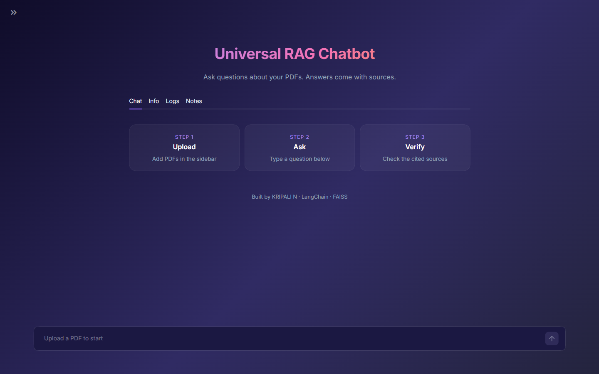
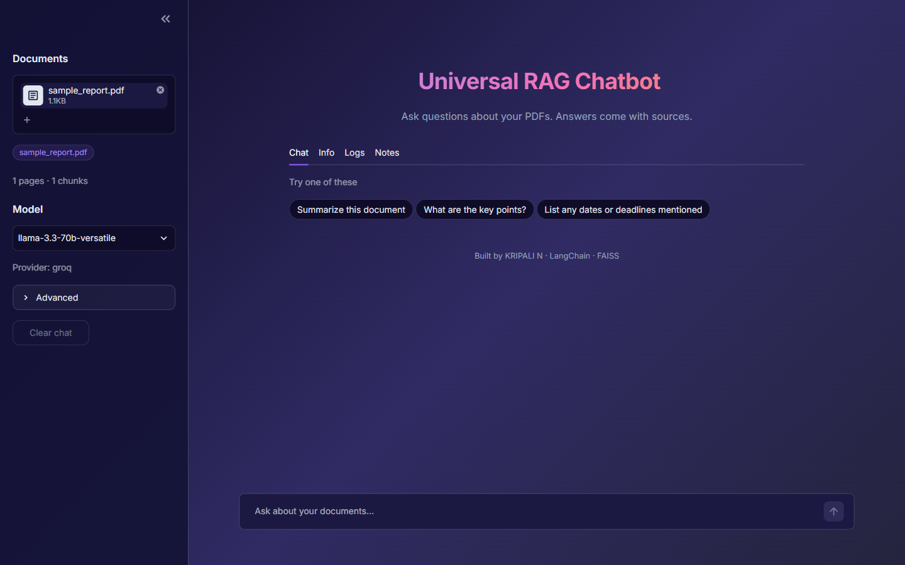
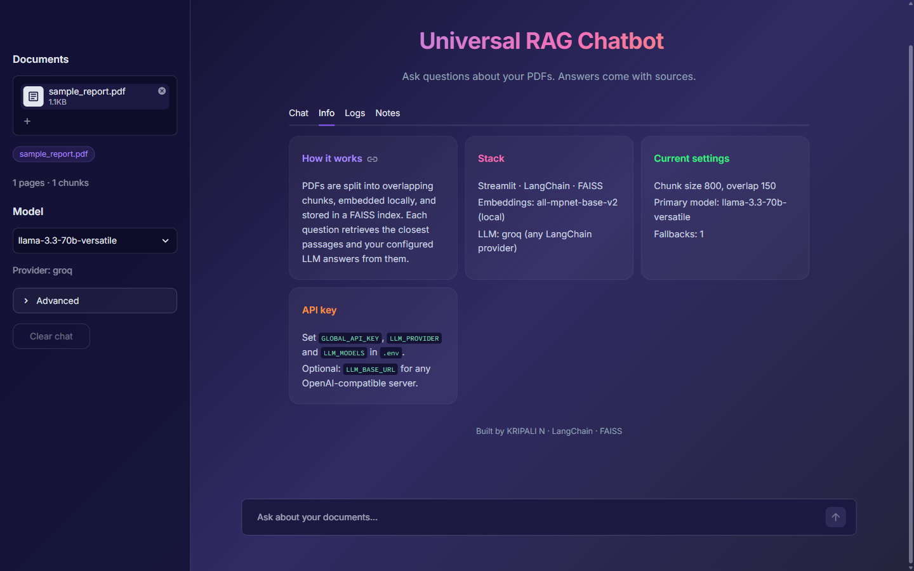

# Universal RAG Chatbot

Chat with your PDFs. Upload one or more documents, ask questions in plain language, and get
answers grounded in your files, with numbered citations back to the source page.

| Home | Documents ready | Info |
|---|---|---|
|  |  |  |

## Features

- **Multi-PDF upload**: text PDFs via PyMuPDF, with an OCR fallback for scanned files.
- **Grounded answers**: the model answers only from retrieved passages and says when the answer isn't in your documents.
- **Citations**: every answer lists its sources as file and page, with a snippet.
- **Streaming**: the answer appears as it's generated.
- **Follow-up questions**: the last three turns are sent with each question.
- **Per-document-set index**: each set of PDFs gets its own saved FAISS index, so re-uploading the same files is instant and different files never mix.
- **Just add a key**: the provider is detected from `GLOBAL_API_KEY`, and the free models that work with it are found automatically.
- **Model fallback**: if the selected model fails, the next one in the list is tried.
- **Sidebar controls**: model picker, Top-K, full retrieved-text view, rebuild index, clear and export chat.
- **Logs tab**: live application log.

## Tech stack

| Layer | Choice |
|---|---|
| UI | Streamlit |
| Orchestration | LangChain (core, community) |
| Vector store | FAISS (local, on disk) |
| Embeddings | `sentence-transformers/all-mpnet-base-v2`, run locally |
| LLM | Any: Groq, OpenAI, Anthropic, Mistral, or an OpenAI-compatible endpoint |

## Quick start

Requires Python 3.10+ and an API key for any supported LLM provider.

```bash
git clone <your-repo-url>
cd <repo-folder>

python -m venv venv
# Windows: venv\Scripts\activate   |   macOS/Linux: source venv/bin/activate
pip install -r requirements.txt

cp .env.example .env        # then set GLOBAL_API_KEY (that is all that is required)
streamlit run app.py
```

Open http://localhost:8501. On Windows you can use `setup.bat` and then `run.bat` instead.

The first upload downloads the embedding model (about 420 MB), so expect it to take a minute.

## Configuration

**Only the API key is required.** Put it in `.env`:

```bash
GLOBAL_API_KEY=your_key_here
```

On startup the app:
1. **Detects the provider** from the key's prefix (`gsk_` Groq, `AIza` Gemini, `sk-or-` OpenRouter, `sk-ant-` Anthropic, `sk-` OpenAI).
2. **Finds the free models that work with your key.** It lists the provider's models and sends each one a 1-token test request, keeping only the models that answer.
3. **Picks the best one,** with the next two working models as automatic fallbacks.

The results are cached for 24 hours in `.model_cache.json`, which stores only a hash of your key, never the key itself. Use **Advanced → Re-check models** in the sidebar to refresh them.

| Provider | Key prefix | Free models? | How they're found |
|---|---|---|---|
| Groq | `gsk_` | Yes (free plan) | List + 1-token test of each model |
| Google Gemini | `AIza` | Yes (free tier) | List + 1-token test of each model |
| OpenRouter | `sk-or-` | Yes (`:free` models) | Models priced at 0 in OpenRouter's catalogue |
| Mistral | none, so set `LLM_PROVIDER=mistralai` | Yes (Experiment plan) | List + 1-token test of each model |
| OpenAI | `sk-` | No | All models listed and marked **paid**. No test calls, because they would cost money. |
| Anthropic (Claude) | `sk-ant-` | No | All models listed and marked **paid**. No test calls. |

Optional settings:

| Variable | Purpose |
|---|---|
| `LLM_PROVIDER` | Skip detection: `groq`, `gemini`, `openrouter`, `mistralai`, `openai` or `anthropic`. Needed for keys with no recognisable prefix. |
| `LLM_MODELS` | Comma-separated model IDs. Skips discovery entirely; the first is primary, the rest are fallbacks. |
| `LLM_BASE_URL` | Any OpenAI-compatible server, such as Ollama, vLLM or Together. Its models are discovered and tested the same way. |

Example for a local model with Ollama (the key can be any non-empty string):

```bash
GLOBAL_API_KEY=ollama
LLM_BASE_URL=http://localhost:11434/v1
```

Chunking (`CHUNK_SIZE`, `CHUNK_OVERLAP`) and the embedding model are constants in `rag.py`.
The theme is in `.streamlit/config.toml`, and the styling is in `style.css`.

## How it works

```
PDFs ──► extract text (PyMuPDF, OCR fallback) ──► split into chunks (800 chars, 150 overlap)
     ──► embed (all-mpnet-base-v2) ──► FAISS index saved in faiss_index_storage/<hash of files>/

Question ──► retrieve Top-K chunks ──► prompt (context + recent turns) ──► LLM ──► streamed answer + sources
```

## Project structure

```
app.py                  Streamlit UI (sidebar, chat, info, logs, notes)
rag.py                  Core pipeline: load, chunk, index, retrieve, answer. No Streamlit imports.
style.css               UI styling
.streamlit/config.toml  Theme
tests/test_rag.py       Unit tests for the core (no network needed)
requirements.txt
Dockerfile
setup.bat, run.bat      Windows helpers
.env.example            Environment template
```

## Testing

```bash
pip install pytest
pytest tests -q
```

## Docker

```bash
docker build -t rag-chatbot .
docker run -p 8501:8501 --env-file .env rag-chatbot
```

## Troubleshooting

| Symptom | Fix |
|---|---|
| "No API key found" | Create `.env` from `.env.example`, set `GLOBAL_API_KEY`, and restart the app. |
| "The model couldn't answer" with a 404 `model_not_found` | Your account can't use that model. Set `LLM_MODELS` to models listed in your provider's console. |
| `pyarrow requires NumPy 2.0` | Run `pip install "pyarrow<20"`. LangChain 0.2 needs NumPy 1.x. |
| Answers come from the wrong document | Open **Advanced → Rebuild index** in the sidebar. |
| Scanned PDF gives no text | The OCR fallback needs `unstructured`'s system dependencies (Tesseract, Poppler). |

## Security notes

- `.env` and `.streamlit/secrets.toml` are gitignored. Never commit keys.
- Uploaded PDFs are processed in temporary files that are deleted afterwards. Only the FAISS index is kept on disk.
- Embeddings run locally. Only the retrieved passages and your question are sent to the LLM provider.
