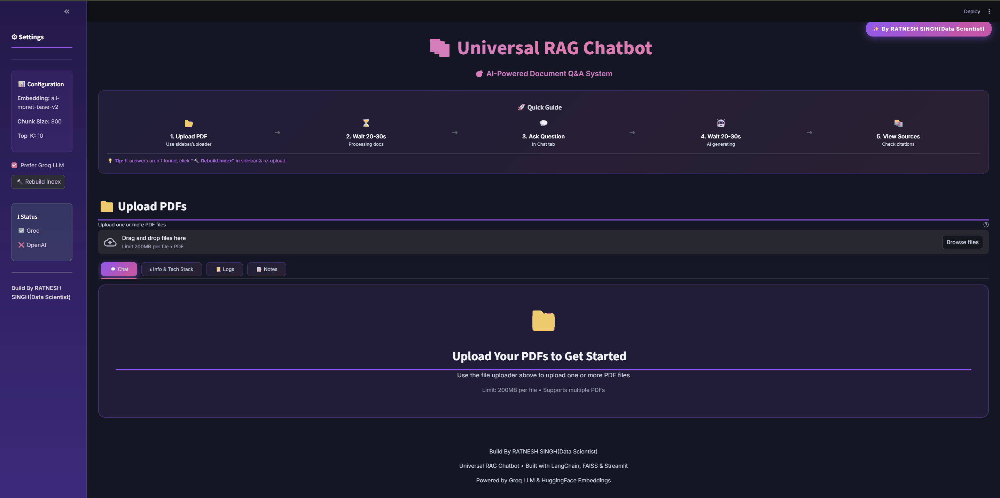

# Universal RAG Chatbot

Chat with your PDFs. Upload one or more documents, ask questions in plain language, and get
answers grounded in your files, with numbered citations back to the source page.



## Features

- **Multi-PDF upload**: text PDFs via PyMuPDF, with an OCR fallback for scanned files.
- **Grounded answers**: the model answers only from retrieved passages and says when the answer isn't in your documents.
- **Citations**: every answer lists its sources as file and page, with a snippet.
- **Streaming**: the answer appears as it's generated.
- **Follow-up questions**: the last three turns are sent with each question.
- **Per-document-set index**: each set of PDFs gets its own saved FAISS index, so re-uploading the same files is instant and different files never mix.
- **Any LLM**: switch provider and model with environment variables. One key in `GLOBAL_API_KEY`.
- **Model fallback**: if the selected model fails, the next one in the list is tried.
- **Sidebar controls**: model picker, Top-K, full retrieved-text view, rebuild index, clear and export chat.
- **Logs tab**: live application log.

## Tech stack

| Layer | Choice |
|---|---|
| UI | Streamlit |
| Orchestration | LangChain (core, community) |
| Vector store | FAISS (local, on disk) |
| Embeddings | `sentence-transformers/all-mpnet-base-v2`, run locally |
| LLM | Any: Groq, OpenAI, Anthropic, Mistral, or an OpenAI-compatible endpoint |

## Quick start

Requires Python 3.10+ and an API key for any supported LLM provider.

```bash
git clone <your-repo-url>
cd <repo-folder>

python -m venv venv
# Windows: venv\Scripts\activate   |   macOS/Linux: source venv/bin/activate
pip install -r requirements.txt

cp .env.example .env        # then set GLOBAL_API_KEY, LLM_PROVIDER and LLM_MODELS
streamlit run app.py
```

Open http://localhost:8501. On Windows you can use `setup.bat` and then `run.bat` instead.

The first upload downloads the embedding model (about 420 MB), so expect it to take a minute.

## Configuration

The app works with any LLM provider through one API key. Set these in `.env`, or in
`.streamlit/secrets.toml` when deployed:

| Variable | Required | Purpose |
|---|---|---|
| `GLOBAL_API_KEY` | yes | API key for the chosen provider. The legacy `GROQ_API_KEY` also works. |
| `LLM_PROVIDER` | no | `groq` (default), `openai`, `anthropic` or `mistralai` |
| `LLM_MODELS` | no | Comma-separated model IDs. The first is primary, the rest are fallbacks. Each provider has a sensible default. |
| `LLM_BASE_URL` | no | Any OpenAI-compatible endpoint, such as OpenRouter, Gemini, Together, Ollama or vLLM. Use it with `LLM_PROVIDER=openai`. |

Examples:

```bash
# Groq
GLOBAL_API_KEY=gsk_...
LLM_PROVIDER=groq
LLM_MODELS=llama-3.3-70b-versatile,llama-3.1-8b-instant

# Claude
GLOBAL_API_KEY=sk-ant-...
LLM_PROVIDER=anthropic
LLM_MODELS=claude-haiku-5-5,claude-sonnet-5-5

# Gemini (OpenAI-compatible endpoint)
GLOBAL_API_KEY=AIza...
LLM_PROVIDER=openai
LLM_BASE_URL=https://generativelanguage.googleapis.com/v1beta/openai/
LLM_MODELS=gemini-2.5-flash

# Local model with Ollama (the key can be any non-empty string)
GLOBAL_API_KEY=ollama
LLM_PROVIDER=openai
LLM_BASE_URL=http://localhost:11434/v1
LLM_MODELS=llama3.2
```

Model IDs change over time, so use the ones listed in your provider's console.
Chunking (`CHUNK_SIZE`, `CHUNK_OVERLAP`) and the embedding model are constants in `rag.py`.
The theme is in `.streamlit/config.toml`, and the styling is in `style.css`.

## How it works

```
PDFs ──► extract text (PyMuPDF, OCR fallback) ──► split into chunks (800 chars, 150 overlap)
     ──► embed (all-mpnet-base-v2) ──► FAISS index saved in faiss_index_storage/<hash of files>/

Question ──► retrieve Top-K chunks ──► prompt (context + recent turns) ──► LLM ──► streamed answer + sources
```

## Project structure

```
app.py                  Streamlit UI (sidebar, chat, info, logs, notes)
rag.py                  Core pipeline: load, chunk, index, retrieve, answer. No Streamlit imports.
style.css               UI styling
.streamlit/config.toml  Theme
tests/test_rag.py       Unit tests for the core (no network needed)
requirements.txt
Dockerfile
setup.bat, run.bat      Windows helpers
.env.example            Environment template
```

## Testing

```bash
pip install pytest
pytest tests -q
```

## Docker

```bash
docker build -t rag-chatbot .
docker run -p 8501:8501 --env-file .env rag-chatbot
```

## Troubleshooting

| Symptom | Fix |
|---|---|
| "No API key found" | Create `.env` from `.env.example`, set `GLOBAL_API_KEY`, and restart the app. |
| "The model couldn't answer" with a 404 `model_not_found` | Your account can't use that model. Set `LLM_MODELS` to models listed in your provider's console. |
| `pyarrow requires NumPy 2.0` | Run `pip install "pyarrow<20"`. LangChain 0.2 needs NumPy 1.x. |
| Answers come from the wrong document | Open **Advanced → Rebuild index** in the sidebar. |
| Scanned PDF gives no text | The OCR fallback needs `unstructured`'s system dependencies (Tesseract, Poppler). |

## Security notes

- `.env` and `.streamlit/secrets.toml` are gitignored. Never commit keys.
- Uploaded PDFs are processed in temporary files that are deleted afterwards. Only the FAISS index is kept on disk.
- Embeddings run locally. Only the retrieved passages and your question are sent to the LLM provider.
